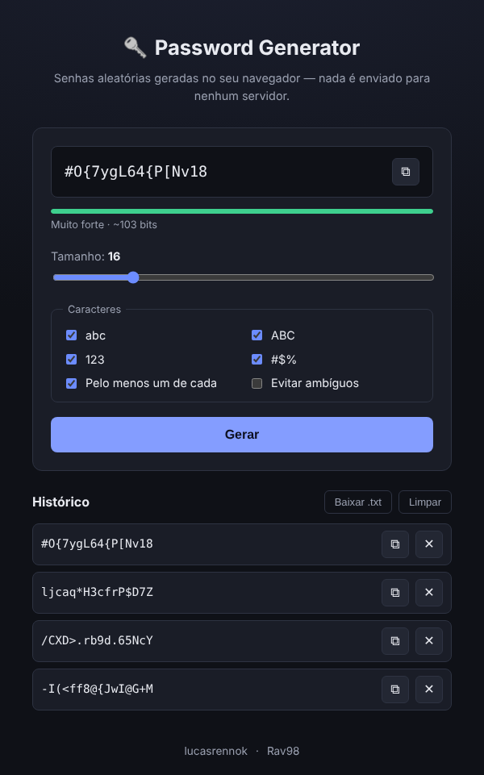

#  Password Generator

Gerador de senhas aleatórias que roda inteiro no navegador — nenhuma senha é
enviada para servidor nenhum.

> [lucasrennok](https://github.com/lucasrennok) · [Rav98](https://github.com/Rav98)

## :gem: Sobre

Projeto antigo (2020), reescrito depois. A geração agora usa
`crypto.getRandomValues` (gerador criptograficamente seguro) em vez de
`Math.random`, que não é adequado para senhas.

## :sparkles: Funcionalidades

- Tamanho ajustável (4 a 64 caracteres)
- Escolha dos tipos de caractere: minúsculas, maiúsculas, números e símbolos
- **Pelo menos um de cada**: garante um caractere de cada tipo marcado
- **Evitar ambíguos**: remove caracteres fáceis de confundir (`i l 1 L o 0 O` etc.)
- Medidor de força com estimativa de entropia (em bits)
- Copiar com um clique, histórico da sessão e download em `.txt`
- Interface responsiva com tema escuro, sem dependências nem build

## :rocket: Como usar

Abra o `index.html` no navegador, ou publique com GitHub Pages
(Settings → Pages → branch `main`).

## :computer: Opções

| Opção | O que faz |
| --- | --- |
| Tamanho | Comprimento da senha |
| abc / ABC / 123 / #$% | Tipos de caractere incluídos |
| Pelo menos um de cada | Obriga ao menos um caractere de cada tipo marcado |
| Evitar ambíguos | Tira caracteres que se confundem visualmente |

## :warning: Observação sobre segurança

A geração usa um CSPRNG e acontece localmente. Ainda assim, para suas senhas
do dia a dia, o ideal é usar um gerenciador de senhas, que também as armazena
com segurança.
